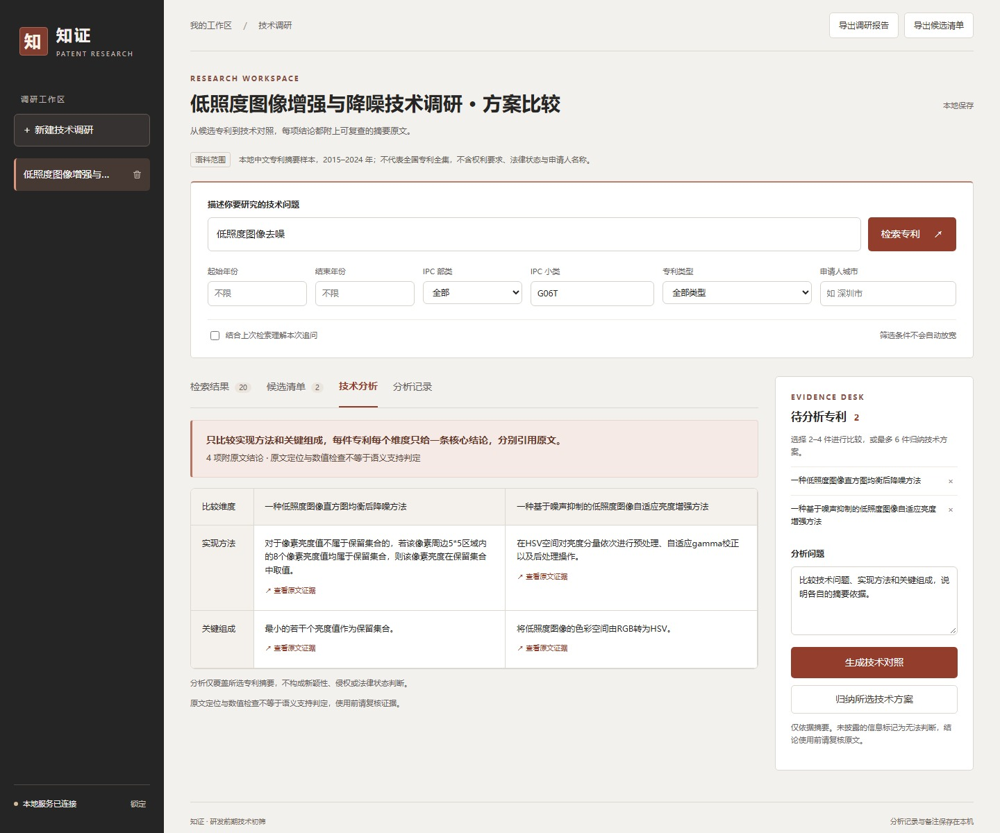

# 知证 · 专利技术调研工作台

在本地专利摘要样本中检索技术方案，选择候选进行带原文证据的比较，保存调研备注并导出报告。

应用层为 **Java 21 / Spring Boot 3.5.16 / LangChain4j 1.23.0**；检索层为 Python / BM25 / BGE-M3 / RRF / reranker；业务记录存储于独立 SQLite 数据库。

## 从 GitHub 获取后

仓库提供源码、测试、评测题和验证记录；语料索引、模型权重、访问令牌、个人调研数据库及运行日志不随代码发布。当前版本没有数据下载或索引重建的一键流程。

首次运行需要 Python 3.11、带 CUDA 的 PyTorch、Java 21、Maven 和 Ollama，并根据 `requirements.txt` 安装 Python 依赖。检索服务当前要求 CUDA，默认配置面向 RTX 4060 Laptop 8GB。

另外准备一套**同一版本、行号一致**的已清洗语料与索引，放在 `assets/corpus/`：

```text
clean/patents.jsonl
index/bm25_fts5.db
index/index_meta.json
index/meta_compact.jsonl
index/patent_emb.npy
index/patent_index_1024.bin
```

这六个文件在本机约 6.22 GiB。单独替换其中一个可能使索引行号与摘要错配，需要整套更新；外部语料和模型的使用条件以各自来源为准。BGE-M3、reranker 路径及 Ollama 模型名称在 `config/workbench.json` 中配置，启动脚本的 Java/Python 路径可用 `-Java` / `-Python` 参数覆盖。



## 使用

在项目根目录运行：

```powershell
.\scripts\Start-Workbench.ps1 -OpenBrowser
```

启动脚本默认使用本机现有环境：

- Java：`D:\Java\jdk-21\bin\java.exe`
- Python：`D:\Anaconda\envs\rag\python.exe`
- Ollama：PATH 中的 `ollama`，模型 `qwen3:4b-instruct-2507-q4_K_M`
- BGE 模型：`D:\models\bge-m3` 与 `D:\models\bge-reranker-v2-m3`

默认访问 `http://127.0.0.1:8088`，检索服务位于 `127.0.0.1:8002`。脚本只绑定本机地址；`-OpenBrowser` 使用本地 URL fragment 完成访问令牌传递，页面随即清除 fragment。直接打开页面时，令牌位于 `data/access.token`。

停止本项目启动的服务：

```powershell
.\scripts\Stop-Workbench.ps1
```

修改 Java 或页面资源后，先停止服务，再执行：

```powershell
.\scripts\Start-Workbench.ps1 -Build -OpenBrowser
```

## 一次完整调研

1. 新建调研并修改标题，例如“低照度图像增强与降噪技术调研”。
2. 输入具体技术问题，设置 IPC、年份、城市等条件，检索候选。条件不会自动放宽。
3. 勾选候选。勾选会保存到本次调研的候选清单；在清单中添加备注。
4. 选择 2–4 件专利生成技术对照，或选择 1–6 件归纳方案。可在分析问题中限定比较维度。
5. 点击结论下的“查看原文证据”，查看完整摘要和高亮片段。
6. 查看待复核内容。数值、单位或引用未通过检查的内容不进入正式结论。
7. 导出 Markdown 调研报告或 CSV 候选清单。重启后使用同一浏览器可继续之前的调研。

侧栏每项调研都有删除按钮，删除前会确认范围；有排队、生成或核验任务时拒绝删除。删除会同时移除该调研的候选、备注与分析记录，原始专利语料保留。

“结合上次检索”会经过同一模型队列生成独立查询，继承的是界面中明确设置的过滤条件。专利选择与筛选状态独立保存，模型无权自行改写硬条件。

## 数据和证据边界

- 当前语料为 **2015–2024 年、519,424 条中文专利摘要样本**，不是全国专利全集。
- 不含完整说明书、权利要求、申请人名称和法律状态，不作侵权、新颖性或保护范围判断。
- `assets/corpus/` 是从原项目复制的运行数据；应用不会写入该目录，也不再依赖原项目目录运行。原始 CSV、旧模型训练文件不是运行依赖。
- 模型权重继续使用本机已有目录，具体位置见 `config/workbench.json`。
- 证据由程序对摘要切片生成，编号包含申请号、摘要哈希值与原文位置；位置按 Unicode code point 计数。
- 审计重新读取规范摘要，核验引用归属和数值/单位。**原文已定位不等于语义蕴含，关系、否定、因果和技术适用性仍需复核。**
- 字符串规则不执行单位换算，也不证明实体—数值关系正确；合法的换算可能进入待复核区。

## 架构和运行控制

```text
浏览器 → Spring Boot :8088
           ├─ 调研 / 工作区 / 候选 / 备注 / 导出 → SQLite
           ├─ 显式上下文 + LangChain4j → Ollama :11434
           └─ 只读检索、证据与审计 → Python :8002 → assets/corpus
```

Java 是唯一运行时模型调用入口。默认生成并发 1、队列容量 4、排队上限 45 秒、生成上限 120 秒，可通过共享配置调整。SSE 推送阶段和审计后的结果；前端不将未审计 token 当作正式结论。

Ollama 的模型级 Flow 接口在本项目固定版本中不可用；`CancellableTransport` 将回调适配到 JDK HTTP 流订阅，使首 token 前也能取消客户端请求。取消属于传输侧 best effort，不能仅靠应用计数断言 GPU 已即时停止。

重启时未完成任务标记为 `interrupted`，不会擅自续跑。失败记录保留已取得的摘要。队列满返回 429，超时与取消都有明确终态。

## 保存与访问

- 业务数据库：`data/workbench.db`，启用 WAL 与外键。
- 共享访问令牌：`data/access.token`；内部服务令牌：`data/internal.token`。
- 每个浏览器工作区另有随机凭据，数据库仅保存密钥散列。所有调研与任务读取都校验工作区归属。
- 浏览器本地保存访问令牌和工作区凭据。此版本面向可信本机使用，提供工作区隔离，不提供企业 SSO 或多租户账号体系。
- 备份数据库前停止服务，备份整个 `data/`，同时妥善保留浏览器工作区凭据。清除浏览器存储后，新工作区不会自动取得旧工作区访问权。
- 运行进程与日志仅位于本项目 `data/`、`logs/`。共享配置不含秘密，不应将 `data/` 或 `assets/` 提交到 Git。

## 验证与评测

```powershell
# 程序级证据、数值和检索指标检查
D:\Anaconda\envs\rag\python.exe -m unittest discover -s tests -v

# Java 集成测试：鉴权、隔离、保存恢复、队列满、取消、无效引用拦截
mvn -f app/pom.xml test

# 对真实 Java -> Python -> Ollama 链路验收；会创建单独的验收工作区
D:\Anaconda\envs\rag\python.exe scripts/run_acceptance.py

# 对真实 Java 入口进行闭环短分析压测
D:\Anaconda\envs\rag\python.exe scripts/load_test.py --requests 100 --concurrency 1,2,4

# 纠正旧系统保存结果的指标口径（不是新系统质量测量）
D:\Anaconda\envs\rag\python.exe eval/recompute_legacy.py
```

`eval/acceptance_cases.jsonl` 是独立编写的需求式验收题，记录出题方式；`eval/build_review_pool.py` 可导出候选与待标注相关性。未完成相关性审阅前，不生成该题集的质量分数。

旧合成回归集的 `Hit@5` 与多 gold `Recall@5` 明确分开。现有排序缓存的复算保存在 `reports/legacy-metrics-corrected.json`，不能作为新工作台的效果提升宣称。

实际执行过的测试、样本量和性能边界以 `reports/VALIDATION.md` 为准，不承诺所有机器或真实流量下都达到同一延迟。

## 目录

```text
app/           Java 应用、页面、集成测试及可执行 JAR
retrieval/     只读混合检索、过滤、证据切分与规则审计
config/        两端共享的运行配置
assets/corpus/ 独立复制的运行数据和索引（不入库）
data/          本项目状态、令牌、数据库与进程记录（不入库）
scripts/       启停、真实链路验收与压测
eval/          指标实现、旧结果对照、需求式验收题与相关性标注池
reports/       实际验证结果与限制说明
docs/          API 和设计决策
```

检索模块由原 CN_Patent_RAG 项目演进，保留原 MIT LICENSE。语料与模型的使用条件以各自来源为准，本项目不声明对这些外部资产的再分发权。

## 开发与面试准备

- [开发问题记录](开发问题记录.md)：开发中确认的问题、处理方式及剩余边界。
- [面试问答](面试.md)：当前架构、LangChain4j 职责、检索与证据、并发取消和真实评测口径。
