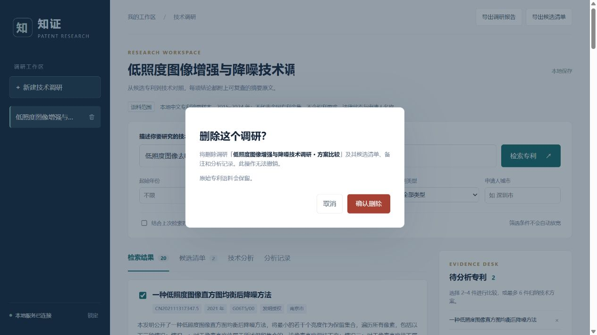

# 单个调研删除功能验证

验证日期：2026-11-12。此记录补充 `VALIDATION.md` 中较早的整体链路验收，不表示重新执行了旧压测或重新测量模型质量。

- Java 当前完整测试套件共 14 项通过，新增覆盖：只删除目标调研并级联清理候选/任务、跨工作区删除返回 404、queued/running/auditing 状态返回 409，任务取消后允许删除。
- 原始测试输出：`study-delete-WorkbenchTests.txt`（13 项）与 `study-delete-CancellableTransportTests.txt`（1 项）；较早的同名无前缀报告属于整体链路验收时的版本。
- 前端 DOM 模拟检查通过：取消不发删除请求、删除非当前调研保留当前分析、删除当前调研切换、最后一项删除后清空、从空态新建、409 错误后保留调研、活动任务保护、改名后的确认标题。
- 实际运行的 Java API 在独立临时工作区中验证：跨工作区 404、关联候选清理、其他调研保留、最后一项删除后列表为空，检索服务仍就绪。
- 浏览器检查：侧栏删除入口可见；弹窗明确列出候选、备注和分析记录；默认焦点为“取消”，取消后原调研仍在。
- 部署前通过 SQLite backup API 备份数据库并检查完整性，只重启本项目 Java 服务；备份、真实业务数据和凭据不提交 Git。

删除属于永久删除，当前没有产品内回收站。规则检查与功能测试不代表语义准确率或生产可用性保证。
